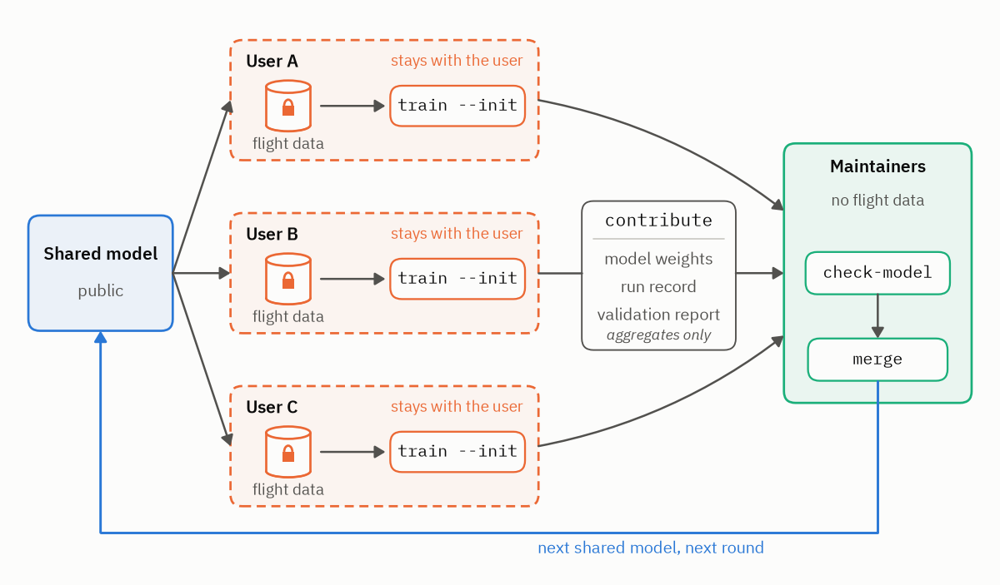
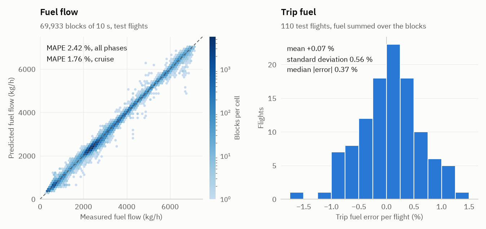
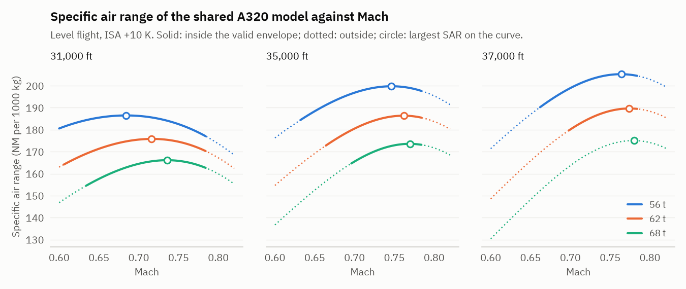

# neuralfuel

neuralfuel is a tool for federated learning of neural aircraft fuel-flow models.

Detailed flight data with fuel information (such as QAR data) is hard to share for privacy reasons, but a small neural network model can often be shared.

The models calculate the total fuel flow from Mach number, pressure altitude, mass, energy-rate variables and static air temperature. The training uses physical constraints.

A user can continue the training of a public shared model on local data and share only the model weights, the run record and an aggregate validation report; the raw data stays with the user. neuralfuel combines the contributions of users into the next shared model without revealing any flight data.



## Install

```sh
uv pip install neuralfuel
uv run neuralfuel --help
```

This installs the library and the command `neuralfuel`. The shared models (`models/`), the examples and the documentation are in the repository (https://github.com/open-aviation/neuralfuel), not in the PyPI package. To get them, clone the repository instead:

```sh
git clone https://github.com/open-aviation/neuralfuel
cd neuralfuel
uv sync
```

The quick start with synthetic data is in [docs/quickstart.md](docs/quickstart.md).

## Shared models

The folder [`models/`](models/README.md) holds the shared models, one folder per aircraft type (lower-case ICAO type code).

For example, [`models/a320/`](models/a320/README.md) holds the models for the A320 with CFM56-5B engines, in two sizes: `nf-a320-cfm56_5b` and `nf-a320-cfm56_5b-xs`. Each model has a PyTorch file (`.pt`), an ONNX file (`.onnx`), a run record and a validation report. The model card `models/a320/README.md` gives the inputs, the valid envelope, the accuracy, the comparison with OpenAP and the limits.

Accuracy of the standard A320 model on the test flights, which were not used in the training:



## Use a neuralfuel model

You can use the shared A320 model to estimate fuel flow as follows. The example needs a clone of the repository and runs from the repository root; the model path is relative to the repository root.

```python
from neuralfuel.model import load
from neuralfuel.inference import fuel_flow

model = load("models/a320/nf-a320-cfm56_5b.pt")
fuel_flow(model, mach=0.78, alt_ft=37000, mass_kg=62000, sat_k=225.0)  # kg/h
```

The model is smooth and obeys the physical constraints, so it can also give performance quantities such as the specific air range ([`examples/02_cruise_performance.py`](examples/02_cruise_performance.py)):



## Contributing to the federated model training

To contribute a model trained on your own data, see [`CONTRIBUTING.md`](CONTRIBUTING.md).

### Contributing with an AI coding agent

The file [`AGENTS.md`](AGENTS.md) gives an AI coding agent the complete workflow with exact commands. You can ask an agent to do the work:

> Read AGENTS.md. Then write an adapter for my data file, check it, train a model and prepare a contribution.

The agent does not read your data. It works from two commands that print summaries only, never rows, identifiers, dates or positions:

- `neuralfuel profile` reports the column names, types, missing fractions and value ranges of the measurement columns.
- `neuralfuel check` tests the converted data against physics. A wrong unit or scale factor gives an error that names the column.

With these two commands the agent can write and correct the adapter that converts your file format to the neuralfuel schema, which is the hardest step for a new user. Every command has a `--json` output and fixed exit codes.

## Documentation

The documentation starts at [docs/index.md](docs/index.md).

## Licence

GPL-3.0-only, see [`LICENSE`](LICENSE).
