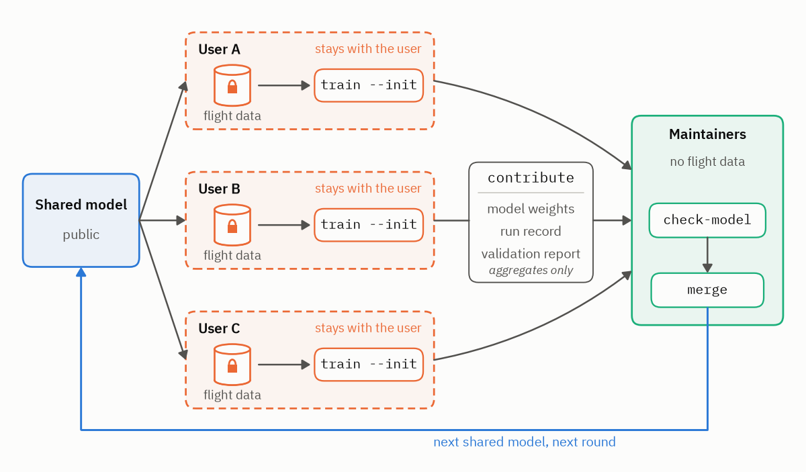

# Federated learning

Detailed flight data with fuel information is hard to share, but a trained model is not. In neuralfuel the shared model is a file, and each user improves it with data that never leaves their own computer. A maintainer combines the contributions of several users into the next shared model.



Users with different operations cover different parts of the flight envelope, such as other temperatures, speeds and weights. A shared model can therefore cover a wider range than the data of one user.

The examples below use the A320 model `models/a320/nf-a320-cfm56_5b.pt`. Use the model of your aircraft type and engine family. One federated round in Python, on synthetic data: [`examples/07_federated_round.py`](../examples/07_federated_round.py).

## Workflow for a user

1. Get the current shared model of your aircraft type and engine family, for example `models/a320/nf-a320-cfm56_5b.pt`.
2. Prepare the local data (`profile`, `check`, `prep`, see [data.md](data.md)).
3. Validate the shared model on your data. This is the validation of the shared model from data: a merged model has no validation report of its own, because the maintainer has no flight data.

   ```sh
   uv run neuralfuel validate work/prep --model models/a320/nf-a320-cfm56_5b.pt --out work/shared_validation.json
   ```

4. Continue the training on the local data:

   ```sh
   uv run neuralfuel train work/prep --init models/a320/nf-a320-cfm56_5b.pt --out work/run
   ```

   The standardization constants, the temperature rule and the aircraft settings of the shared model are kept, so the models of different users stay compatible. The constraint settings of the shared model are kept too, the settings of the drag-rise term P7 included: a contribution from a shared model with P7 trains with P7 and the stored P7 settings. The training rebuilds the drag-slope table of P7 from the stored settings with the installed aerox. If the rebuilt table does not have the stored SHA-256, the drag table of the shared model cannot be reproduced: the training stops with exit code 2, and the message names the aerox version of the model and the installed aerox version. Install the aerox version of the model in that case. A model with P7 settings and no stored SHA-256 also stops the training with exit code 2. `--aircraft` and `--engine` are ignored with `--init`. The training protects the shared model against forgetting (see below). The first output line gives the hash of the base model and the protection setting. `--no-protect` switches the protection off; do not use it for a contribution.

5. Validate locally and export:

   ```sh
   uv run neuralfuel validate work/prep --model work/run/model.pt --out work/run/validation.json
   uv run neuralfuel export --model work/run/model.pt --out work/run/model.onnx
   ```

   The report holds accuracy numbers, physical checks and the coverage of the local data ([validation.md](validation.md)). It has no flight identifiers, dates, positions or aircraft labels.

6. Run the quality check against the shared model. It reads `work/run/run.json`. If a check fails, see "When check-model fails" below. `contribute` needs the report of the test split only (the default of `validate`).

   ```sh
   uv run neuralfuel check-model work/run/model.pt --base models/a320/nf-a320-cfm56_5b.pt
   ```

7. Assemble the contribution:

   ```sh
   uv run neuralfuel contribute --run work/run --report work/run/validation.json --out work/share
   ```

   The folder `work/share` must be new or empty. It holds the weights, the ONNX file made from them, the run record, the report of the test split and `MANIFEST.json` with checksums. The run record and the report hold only the keys of their formats, each with a value of the declared shape (numbers, bounded lists of numbers, and strings of a fixed set or a strict pattern; no free text). `contribute` drops other keys and values and lists their paths in its output (`dropped_fields`); the list stays on your computer, and `MANIFEST.json` holds only their number. Put its files in `contributions/<short neutral name>/` and open a pull request (see [`CONTRIBUTING.md`](../CONTRIBUTING.md)).

8. Optional, private: fit the local offsets of each aircraft (see "Private local correction" below). They stay on the computer of the user.

The **declared region** of a contribution is the envelope of its local training data: the region where the contribution has data. The run record holds it as `local_envelope`. The model file gets the union of the envelope of the shared model and the local envelope. A model continued from a file without an envelope gets only the local envelope.

## Workflow for a maintainer

The maintainer needs no flight data.

1. Run the quality check on each contribution against the shared model it continued from. The run record of the contribution is required:

   ```sh
   uv run neuralfuel check-model contributions/NAME/model.pt --base models/a320/nf-a320-cfm56_5b.pt --run contributions/NAME/run.json
   ```

2. Compare the contribution with reference models, and with the current shared model:

   ```sh
   uv run --group reference neuralfuel compare --model contributions/NAME/model.pt --against models/a320/nf-a320-cfm56_5b.pt
   ```

3. Review the pull request: the run record, the validation report, the quality check and the comparison.
4. Combine the accepted contributions into the next shared model. Write it to a new folder first, not over the base:

   ```sh
   uv run neuralfuel merge contributions/NAME1 contributions/NAME2 --base models/a320/nf-a320-cfm56_5b.pt --out next/nf-a320-cfm56_5b.pt
   ```

   `merge` needs the run record (`run.json`) of every contribution; without it, the exit code is 2. It checks each run record with the same check as `contribute` and `check-model` (see "Quality check of a contribution"). It refuses (exit code 1) a contribution with another architecture, temperature rule, aircraft settings or standardization constants, a run record of other weights, a run record that names another base model or no base model, a model file that names another base than its run record, a run record without a declared region, a declared region that does not give the envelope of the model, non-finite parameters, the same contribution twice and the base itself as a contribution. It writes the weights file and, next to it, the merge record `nf-a320-cfm56_5b.merge.json` (see "Merge record" below). If the quality check of the merged model cannot run (for example P7 settings of the base without `table_sha256`), `merge` still writes both files, but the merged model is unchecked: the output says "NOT RUN", `quality_check` has `ok` null and the reason in `error`, and the exit code is 1. A quality check that runs and fails does not change the exit code; read `quality_check` in the merge record.

5. Export the merged model to ONNX:

   ```sh
   uv run neuralfuel export --model next/nf-a320-cfm56_5b.pt --out next/nf-a320-cfm56_5b.onnx
   ```

6. Publish the merged model as the new shared model: copy the `.pt`, the `.onnx` and the `.merge.json` into the folder of the aircraft type (`models/a320/`) and update the model card `models/a320/README.md`. The previous `.run.json` and `.validation.json` belong to the previous weights: remove them from `models/`. `tests/test_shared_models.py` checks the hash of each shared model against its `.run.json` (a model trained directly) or its `.merge.json` (a merged model); see [`models/README.md`](../models/README.md). The validation reports of the contributions stay with the contributions in `contributions/`. The users validate the new shared model on their own data in the next round (step 3 of the user workflow). The next round starts from it.

## Protection against forgetting

When `train` continues from given weights, a frozen copy of these weights is the teacher. The loss term `teacher` (weight `loss.teacher`, default 10) is the mean squared difference of ln fuel flow between the model and the teacher, on a fixed set of 262,144 points (`loss.n_teacher_points`):

    teacher = mean of w(x) (f(x) - f_teacher(x))²

Half of the points are collocation states over the aircraft envelope. The other half are drawn inside the valid envelope of the given model, per phase, so that the low altitudes and the energy-rate inputs of the shared data are included. Points inside the envelope of the local training data have weight w = 0: there the local data decide. Elsewhere w = 1. Each update step uses a random batch of 4,096 of these points, drawn with a separate random generator.

A model file without a valid envelope (a model not trained with `train`) gives only the points over the aircraft envelope. The run record then has a warning in `protection.warning`, and the continued model gets only the local envelope. `--no-protect` (or `--set loss.teacher=0`) switches the protection off. Training from scratch has no teacher.

## Aggregation

`neuralfuel merge` (Python: `neuralfuel.aggregate`) combines contributions that continued from the same base model. It does one round; for more rounds, the users continue from the merged model and the maintainer merges again. Both methods need the run record of every contribution.

- `--method average` (default): the trainable parameters of the contributions are averaged; the buffers (the standardization constants and a fixed temperature exponent) are copied from the base. The merged model has the constraint settings of the base (P7 included). `merge` does not compare the constraint settings of a contribution with those of the base; `check-model` compares only the P7 settings (check `drag_table`). `--weights` gives equal weights (`equal`, the default), weights by the number of training blocks in the run records (`blocks`), or a comma-separated list of finite positive numbers.
- `--method combine`: output combination. A student model starts from the base and is trained on points with target values, without flight data. At a point inside the declared region of one or more contributions, the target is the mean of these contributions. At a point outside every declared region, the target is the base model. Half of the points (2^20 in total) are collocation states over the aircraft envelope with acc_in in +-0.03, half are drawn inside the declared regions. The student runs the full step budget (`--steps`, default 19,500) without early stopping and keeps the state with the lowest loss on a separate set of 2^16 points. `--seed` sets the student seed and `--device` the device (`auto` uses the GPU if there is one). The phase rule and the constraint settings (P7 included) come from the base. `combine` checks that the envelopes of the base and of the declared regions can be joined before it trains. It takes about 10 minutes on a CPU.

The merged model gets the union of the envelope of the base and the declared regions of the contributions. The union is a box per phase (the lowest minimum and the highest maximum of each variable), so it can span gaps between the regions of the contributions: a state inside the union is not always near training data. The block and window counts of the union are sums. Over several rounds they count training exposures, not unique observations: a contribution trains on its local data and the base, which already holds the earlier rounds, so the same data can count once per round.

## Merge record

The weights file of the merged model records the hashes of the base and of every contribution, and the weights, in the meta entry `aggregation` (`neuralfuel.model.read_meta`). The merge record `<name>.merge.json` next to the weights file holds:

- `method`, `base_weights_sha256`, `contributions` (the weights hash and the weight of each), `weights_sha256` of the merged model;
- for `combine`: the numbers of points, the validation loss and the steps;
- `envelope`: the union envelope;
- `quality_check`: the result of the quality check of the merged model against the base, with the union of the declared regions as the declared region; `ok` is null and `error` gives the reason if the check could not run.

The merged model has no validation report from data.

## Quality check of a contribution

`neuralfuel check-model` (Python: `neuralfuel.quality.check_model`) compares a contribution with its base model, without flight data. It needs the run record of the contribution: `--run`, or `run.json` next to `model.pt`. A run record of other weights is bad input (exit code 2). The run record is checked with the same check as in `contribute` and `merge` (`neuralfuel.aggregate.record_problems`): the weights hash of the run record and of the meta entry of the model file, the base hash of both, the declared region of a continued model, the block and window counts of the run record against the declared region, and the envelope of the model against the union of the base envelope and the declared region. For each check it gives a value, a warning limit, a failure limit and pass, warn or fail. All limits are in `LIMITS` in `src/neuralfuel/quality.py`. A value above the failure limit fails, a value above the warning limit warns. A measured value that is not finite (NaN or infinite) fails. A check without a value, because the quantity could not be measured (for example no state of the grid inside the base envelope), warns. Exit code 1 means at least one check failed.

| check | value (unit) |
|---|---|
| `finite` | yes if all parameters and outputs are finite |
| `compatible` | yes if the architecture, inputs, temperature rule, aircraft settings and standardization are equal to the base; the note lists the differences |
| `base` | yes if the run record names the base model (`init_weights_sha256`) and the meta entry of the model file names the same base; a model from scratch fails |
| `declared_region` | yes if the run record has the declared region (`local_envelope`), its counts agree with the run record and the envelope of the model is the union of the base envelope and the declared region; a run record without the declared region fails |
| `protection` | teacher weight of the protection against forgetting in the run record; 0 fails |
| `drag_table` | yes if the contribution has the P7 settings of the base (`constraints.drag_rise`, without `aerox_version`) and the installed aerox rebuilds the stored drag-slope table of P7 of the base (`table_sha256`); only for a model with P7 settings; the note names the aerox version of each model and the installed aerox version, and says when the P7 settings differ |
| `constraint_delta` | largest increase of the violation rates of P1 to P3 on the constraint grid of the validation, of P6 and, for a base with P7 settings, of P7 (percentage points) |
| `fuel_level` | \|median fuel-flow ratio contribution / base - 1\| in steady cruise inside the base envelope and the declared region (%); catches wrong units and scale errors; `states` gives the number of cruise grid states used. Without such a state the check is not measured: no value, a warning |
| `region_type` | share of the declared region with a mass outside the range of the type or a Mach above the MMO (fraction) |
| `change_outside_mean`, `change_outside_max` | mean and largest change of fuel flow inside the base envelope and outside the declared region (%) |
| `outside_states` | number of test states inside the base envelope and outside the declared region; below 1,000 (`MIN_OUTSIDE_STATES`) it warns, because the two checks above then say little |
| `mach_mean` | \|mean(Δs)\|: the absolute value of the mean of the signed change Δs of the cruise Mach sensitivity s = d ln F / dM inside the base envelope (1 per Mach); changes of opposite sign cancel; the note gives the signed mean |
| `mach_max` | max \|Δs\|: the largest absolute change of s on the same states (1 per Mach); the note gives its sign |
| `best_mach` | largest absolute change of the Mach of maximum specific air range (Mach) |
| `smoothness` | ratio of the mean Hessian norm of ln F, contribution / base, inside the base envelope (ratio) |

Details of each check (`src/neuralfuel/quality.py`):

- `fuel_level`, `mach_mean`, `mach_max` and `best_mach` use a cruise grid made from the aircraft settings: Mach from MMO - 0.12 to MMO - 0.02 in steps of 0.01, altitudes from 10,800 ft to 800 ft below the maximum altitude in steps of 1,000 ft, and 6 masses from 15 % to 91 % of the mass range, at the ISA deviation in the middle of the level-flight range of the base envelope. For the stored aircraft settings of the shared A320 models this is Mach 0.70 to 0.80, 29,000 to 39,000 ft and 47.9 to 74.8 t. `best_mach` uses the grid points whose state at MMO - 0.06 is inside the base envelope.
- `region_type` draws 2,000 states from the declared region. A mass below 0.9 times the lowest or above 1.1 times the highest mass of the type, or a Mach above MMO + 0.02, counts as outside the type.
- `change_outside_*` use 65,536 collocation states over the aircraft envelope and 32,768 states drawn inside the envelope of the base.
- `constraint_delta` and `smoothness` use the constraint grid of the validation report (see [validation.md](validation.md)).
- `drag_table` compares the P7 settings first. It fails if the P7 settings of the contribution differ from those of the base, or if only one of the two has P7 settings: `constraint_delta` measures P7 of both models with the settings of the base. The key `aerox_version` is not compared: continued training records the installed aerox version, and `table_sha256` already shows that the table is the same. With the same settings, the contribution has the table of the base, so only the table of the base is rebuilt, and the stored grid of the contribution never sets the size of a table. `drag_table` fails if the table of the base rebuilt with the installed aerox does not have the stored SHA-256; the P7 values of `constraint_delta` then use a table that neither model was trained with. P7 settings without a stored SHA-256, and a table grid with more than 1,000 points on an axis or 2,000,000 cells (`neuralfuel.drag`), are bad input (exit code 2).
- `fuel_level` uses the cruise grid states inside the base envelope and inside the declared region (without a run record and a declared region: inside the base envelope). If no state is inside both, the check is not measured; it does not fall back to other states.

The failure limits are the loose limits of the acceptance-gate experiments on the A320 dataset: 1.25 times the largest value of 51 good contributions (six scenarios of data splits between users, three seeds, protected continued training with the settings of the shared models). The values were computed with the statistics above (for `mach_mean` the absolute value of the signed mean). The warning limits are 1.25 times the 90 % quantile of the same values. They are limits for that dataset and model size; another type or data source may need other limits.

### When check-model fails

Read the `note` of each failed check. Then:

- `declared_region`: the run record is not the one that `train` wrote for these weights, or it was edited. Use the run record of the training.
- `finite`, `compatible`, `base` or `protection`: train again with `--init` from the shared model that you name as the base, without `--no-protect`, and do not change the temperature rule or the aircraft settings.
- `drag_table`: if the note says that a table is not reproduced, install the aerox version of the base model that the note names and run the check again. If the note says that the P7 settings differ, train again with `--init` from the base model; the training then keeps its P7 settings.
- `fuel_level`, `region_type`: check the units and scale factors of the adapter (`neuralfuel check`). Mass in pounds and fuel flow in another unit are the usual causes.
- `change_outside_*`, `mach_*`, `best_mach`, `smoothness`, `constraint_delta`: the training moved the model far from the base. Check that the protection was on and that the training used the default budget.

Do not submit a contribution that fails. If you think a failure is wrong, describe it in the pull request. A model trained on the synthetic data is expected to fail `fuel_level` and the Mach checks against the shared A320 model, because the physics of the synthetic data differs from the real aircraft. A warning does not stop a contribution; describe it in the pull request.

This is a quality check for honest mistakes: wrong units, missing protection, diverged training. It is not a security barrier. It cannot detect training on inaccurate airspeed, and it cannot detect a false statement of the data region. The maintainers review each pull request and also compare the model with reference models.

## Comparison with reference models

`neuralfuel compare --model M` (Python: `neuralfuel.reference.compare`) evaluates the model and a reference fuel model on a fixed grid of states inside the envelope of the model: steady cruise (Mach x altitude x mass), climb and descent (at the middle vertical speed of the phase). It reports the fuel-flow ratio model / reference per phase (median, 5 % and 95 % quantiles), the cruise Mach sensitivity d ln F / dM of both (median over the grid, and the median of the pointwise ratios model / reference), and the Mach of maximum specific air range of both at three altitudes and three masses. The search runs from MMO - 0.22 to the MMO, also outside the envelope of the model. A best-range Mach at the upper bound of the search (the MMO) is marked with `*` (`model_at_upper_bound`, `reference_at_upper_bound` in the JSON output), at the lower bound with `_` (`model_at_lower_bound`, `reference_at_lower_bound`), and outside the valid envelope of the model with `!` (`model_outside_envelope`, `reference_outside_envelope`: the state of level flight at that Mach, altitude, mass and ISA deviation). A marked Mach is a limit of the search or an extrapolation of the model, not an optimum inside the envelope.

The reference sees the pressure, the static temperature, the Mach and the flight-path angle of the model state. OpenAP (and its BADA 4 add-on) take a geometric altitude and a temperature shift of the whole atmosphere, so `neuralfuel.reference.openap_conditions` converts the state. OpenAP limits the shift to -25 to +15 K. Where a larger shift is needed (warm days at low altitude), the pressure, the Mach and the flight-path angle stay the same and the temperature is the nearest that OpenAP can represent. The OpenAP fuel flow does not depend on the temperature at a fixed pressure, Mach and flight-path angle; BADA 4 does.

- `--reference openap` (default; `openap:A320` names the type): OpenAP, in the optional dependency group `reference` (`uv sync --group reference`).
- `--reference bada:NAME`: BADA 4 through the OpenAP add-on, for a user with a BADA licence. The path of the local BADA 4 table folder comes from the environment variable `NEURALFUEL_BADA` or from `bada_path` in the `[reference]` table of `local.toml`. No BADA data ships with the package. The output then has ratios only, no absolute BADA value. Never write BADA values or coefficients to a tracked file.
- `--against previous/model.pt`: another neuralfuel model, for example the previous shared model. Its name in the output is `model:<file stem>-<first 8 characters of the weights hash>`, so two files with the same name stay apart; the output holds no file paths.

A reference is a plain function `ref(mach, alt_ft, mass_kg, dT_isa_k, vs_fpm) -> kg/h` (`neuralfuel.reference`), so other references can be added. The comparison of the shared A320 models with OpenAP is in the model card. A small comparison on a grid of your choice: [`examples/09_compare_openap.py`](../examples/09_compare_openap.py).

## Private local correction

```sh
uv run neuralfuel local-fit work/prep --model models/a320/nf-a320-cfm56_5b.pt --out work/private/offsets.json
```

`local-fit` (Python: `neuralfuel.local.fit_offsets`) fits three offsets in ln fuel flow for each aircraft: one for climb, one for level flight and one for descent. The phase comes from the model inputs (geometric vertical speed above +300 ft/min: climb, below -300 ft/min: descent, else level). Each offset is the mean residual ln F (measured) - ln F (model) of the training blocks of that aircraft and phase (`--split`, default `train`). The aircraft come from the optional `tail` column of the prepared data; without it, all data are one aircraft with the label `"all"`.

The offsets are written to their own JSON file. They are never stored in a model file, a run record, a contribution or a validation report. Apply them with `predict(model, x, offsets=offsets_for(read_offsets(path), label))` (`neuralfuel.local`, see [use.md](use.md)). The label is the `tail` label of the aircraft; without a `tail` column it is `"all"`. The file holds the weights hash of the model they were fitted against; `predict` gives a warning when they are applied to another model. The offsets make a step in fuel flow at the phase borders. Use them for fuel estimation, not inside a trajectory optimizer. Example: [`examples/08_local_offsets.py`](../examples/08_local_offsets.py).

## Limits of the federation tests

- The limits of the quality check (`check-model`) were derived from the same simulation runs that tested them. They are not tested on independent contributions.
- All federation tests used one dataset with two aircraft.
- The BADA comparison needs a licensed local BADA copy. No BADA data ships with the package, so a maintainer without a licence compares with OpenAP only.
