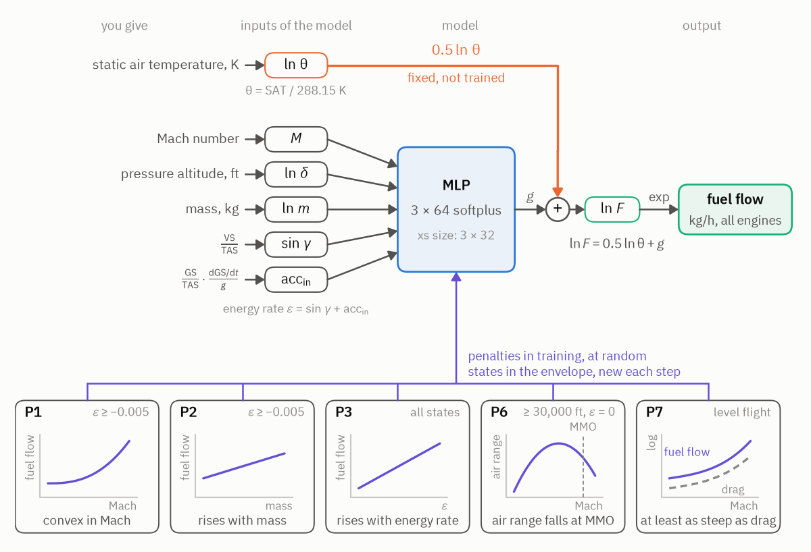

# Model

The model gives the total fuel flow of all engines (kg/h) of one aircraft type from Mach, pressure altitude, mass, two energy-rate inputs and the static air temperature. It covers flight in clean configuration (flaps and slats retracted) with the speed brake and the landing gear retracted. The default settings are for the A320.

## Inputs and output

The model has six inputs, always in this order (`FEATURES` in `src/neuralfuel/prep.py`):

| input | definition | unit |
|---|---|---|
| `mach` | Mach number | - |
| `ln_delta` | ln delta; delta = p / p0 is the ISA pressure ratio at the pressure altitude, p0 = 101,325 Pa | - |
| `ln_m` | ln of the mass | mass in kg |
| `sin_gamma` | (geometric vertical speed) / (true airspeed) | - |
| `acc_in` | (groundspeed / true airspeed) x (d groundspeed / dt) / g, with g = 9.80665 m/s² | - |
| `ln_theta` | ln theta; theta = SAT / 288.15 K, SAT is the static air temperature | - |

The output is `ln_fuel_flow`, ln of the total fuel flow in kg/h. The function `neuralfuel.atmos.isa_delta` gives delta. At 37,000 ft, delta is 0.2138.

Definitions used in all pages:

- **Geometric vertical speed**: the pressure-altitude rate times SAT / T_ISA, where T_ISA is the ISA temperature at the pressure altitude.
- **Energy-rate inputs**: `sin_gamma` and `acc_in`. Both are inertial: they use the geometric vertical speed and the groundspeed, not the airspeed rate. Their sum eps = sin_gamma + acc_in is the energy rate. In still air without acceleration, eps = sin_gamma.
- **W/delta**: the mass divided by delta, in tonnes. In steady level flight at a given Mach, W/delta fixes the lift coefficient, so the tests group cruise states by W/delta.
- **ISA deviation**: SAT - T_ISA, in K.
- **Phase**: climb above +300 ft/min and descent below -300 ft/min geometric vertical speed, else level. Cruise is level flight above 25,000 ft.
- **Specific air range**: true airspeed / fuel flow. The Mach of maximum specific air range is also called the best-range Mach.

In the preparation of the data, the derivatives come from a Savitzky-Golay filter (21 s, order 2) inside each continuous segment. Mach comes from CAS and pressure altitude, SAT from TAT and Mach (see [data.md](data.md)).

## Network and sizes

The network is a multilayer perceptron with 3 hidden layers of softplus units. Every model is released in two sizes (`SIZES` in `src/neuralfuel/aircraft.py`):

| size | network | weights |
|---|---|---|
| `standard` | 3 hidden layers of 64 units | 8,769 |
| `xs` | 3 hidden layers of 32 units | 2,337 |

The standardization constants of inputs and output are fixed from the training data and stored in the model, together with the temperature rule, the exponent, the aircraft-type settings, the constraint settings of the training and the valid envelope, so the weights file is self-contained. `neuralfuel.model.load` refuses a file above 64 MiB and an architecture with more than 8 layers or more than 1,024 units per layer before it builds the network.

`load` reads only files of the format `neuralfuel-weights-1` and refuses a file of another format.

A network made in code (for example `FuelFlowNet.from_data`) and not trained with `train` has no valid envelope and no constraint settings, and has no aircraft-type settings unless they are given. Its saved file loads without them. `validate` then needs `--aircraft` (and `--engine`), and the validation uses the default constraint settings.

## File names

A model file is named `nf-<type>[-<engine family>][-xs].pt`, all in lower case, and the ONNX file has the same stem with `.onnx`. Examples: `nf-a320-cfm56_5b.pt` (A320 with CFM56-5B engines, standard size), `nf-a320-cfm56_5b-xs.pt` (small size). A name without an engine family, such as `nf-a320.pt`, is the generic model of the type, trained on data of all its engine variants. `neuralfuel.aircraft.model_name` builds the name.

## Aircraft-type settings

The physical constraints use envelope values of the aircraft type: the maximum operating Mach (MMO), the maximum operating CAS (VMO), the mass range and the altitude range. The reference wing area gives the lift coefficient of the valid envelope; it is optional. These are settings of the type (`neuralfuel.aircraft`), stored in the model file, the run record and the validation report together with the type and the engine family.

For a type that the [aerox](https://pypi.org/project/aerox/) library has, the default values come from aerox (`aerox.load_aircraft` with the upper-case ICAO type code):

| setting | aerox field |
|---|---|
| `mmo` | `mmo` |
| `vmo_kt` | `vmo` |
| `mass_kg` | (`oew`, `mtow`) |
| `alt_ft` | (10,000 ft, `ceiling`) |
| `wing_area_m2` | `wing.area` |

The lower altitude of 10,000 ft (`ALT_LOW_FT` in `neuralfuel.aircraft`) is a modelling choice of neuralfuel: the lower bound of the collocation states. It is not a property of the aircraft. Below 10,000 ft, ATC restrictions such as the speed limit set the flown states, so the constraints are not applied there; the model still gives predictions there from the data. For the A320 with CFM56-5B engines, aerox gives MMO 0.82, VMO 350 kt, mass 42,600 to 78,000 kg, ceiling 39,800 ft and wing area 122.0 m². The shared A320 models in `models/a320/` hold these values.

A value that aerox does not have, and every value of a type that aerox does not have, is missing. Give it with `--set` to `train` or `release`; `train` stops with an error while an envelope value is missing. A value given with `--set` overrides the aerox value. For example, for a type that aerox does not have: `--aircraft x1 --set aircraft.mmo=0.82 --set aircraft.vmo_kt=340 --set aircraft.mass_kg=[42000,79000] --set aircraft.alt_ft=[10000,41000] --set aircraft.wing_area_m2=124.6`.

A model file holds the aircraft-type settings that it was trained with. A loaded model uses these stored values, not aerox, and a model trained further with `train --init` keeps the stored values of the given model.

## Temperature rule

By default the model is

    ln F = 0.5 ln theta + g(Mach, ln delta, ln mass, sin_gamma, acc_in)

with F the fuel flow and g the network. At a fixed Mach, pressure altitude and mass, fuel flow then scales with the square root of theta, the usual temperature correction of engine fuel flow, and the Mach of maximum specific air range does not depend on temperature.

Each altitude of the training data covers only a small range of temperature, so a network with theta as a free input can learn temperature effects that the data do not support. On the A320 dataset it moved the Mach of maximum specific air range by -0.055 between ISA -20 K and +20 K, and its test accuracy was not better than with the fixed rule.

The setting `temperature` of the training configuration selects the rule:

- `fixed` (default): exponent `theta_exp` = 0.5, not trained;
- `learn`: the exponent is trained, starting at `theta_exp`;
- `free`: ln theta is a network input.

All settings take the same six inputs.

## Loss and physical constraints

The training minimizes a weighted sum of terms. Each term has a weight in `LossConfig` (`src/neuralfuel/losses.py`); weight 0 switches a term off. Below, f = ln F, and f_X is the derivative of f with respect to X.

| term | default weight | meaning |
|---|---|---|
| `points` | 1 | MSE of ln fuel flow on the 10 s blocks |
| `window` | 0.1 | MSE of ln fuel flow on the steady 300 s windows (batch of 512 windows per step) |
| `mach_convexity` (P1) | 0.001 | fuel flow convex in Mach at powered states |
| `mass_monotone` (P2) | 0.001 | fuel flow increases with mass at powered states |
| `energy_monotone` (P3) | 0.001 | fuel flow increases with energy rate |
| `range_boundary` (P6) | 0.001 | specific air range decreases at the MMO of the type at cruise altitudes |
| `drag_rise` (P7) | 0.01 | in level flight, fuel flow rises with Mach at least as fast as the drag of the aerox drag model (only for a type with an aerox drag model with wave drag) |
| `teacher` | 10 | only when training continues from given weights: stay close to them outside the local data (see [federated.md](federated.md)) |

The constraints are hinge penalties: the mean squared violation of an inequality.

- P1: f_MM + f_M² >= 0, which is d²F/dM² >= 0. Only at powered states, eps >= -0.005 (`eps_powered`). Penalty: mean of max(0, -(f_MM + f_M²) x 0.1²)².
- P2: f_ln m >= 0. Only at powered states, eps >= -0.005 (`eps_powered`). The required thrust is T = D + W eps, so dT/dW = dC_D/dC_L + eps. Below a limit descent angle (for the A320 at eps of about -0.03 to -0.05) the required thrust decreases with mass until the engines reach idle, and the fuel flow can decrease with mass. Penalty: mean of max(0, -f_ln m)².
- P3: f_eps >= 0. Penalty: mean of max(0, -0.02 f_eps)².
- P6: M f_M >= 1.1 (`p6_min`) at M = MMO and eps = 0. The specific air range M a / F decreases with Mach where M f_M > 1. Penalty: mean of max(0, 1.1 - MMO f_M)².
- P7: f_M >= g at eps = 0, with g = d ln D / dM the Mach slope of the drag at a fixed pressure altitude and mass (fixed W/delta, so CL varies as 1 / M²). In steady level flight F = TSFC x D, so f_M = g + d ln TSFC / dM. TSFC does not decrease with Mach, so the Mach slope of fuel flow in level flight is at least that of drag. Penalty: mean of max(0, g - f_M)².

P1 to P3 are evaluated on 4,096 random states per step (`n_colloc`), uniform in the flight envelope: Mach from 0.45 to the MMO, CAS from 180 kt to the VMO, the mass and altitude ranges of the type, eps from -0.08 to +0.08 and ISA deviation from -15 to +25 K (`Envelope` and `LossConfig`). P1 and P2 use only the states with eps >= `eps_powered`; P3 uses all of them. P6 uses random states at the MMO between 30,000 ft (`p6_alt_min_ft`) and the maximum altitude of the type. These states use still air: sin_gamma = eps and acc_in = 0.

P7 uses its own 4,096 random level-flight states per step: Mach from `drag_rise_mach_min` (default 0.70) to the MMO, the altitude, mass and ISA-deviation ranges above, CAS from 180 kt to the VMO, and a lift coefficient (with the wing area of the type) not above `drag_rise_cl_factor` (default 1.1) times the largest lift coefficient of the cruise windows of the valid envelope. g comes from the full drag model of [aerox](https://pypi.org/project/aerox/) (`aerox.models.drag.build_drag_model`, with its wave drag) at ISA temperature. `neuralfuel.drag` evaluates it once per training on a table: a regular grid in Mach (step 0.005, from `drag_rise_mach_min` to the MMO), lift coefficient (step 0.01, from 0.05 to the bound above) and ln delta (12 values over the altitude range of the type). The training interpolates the table (trilinear; a state outside the grid takes the value at its edge).

P7 is on by default where it is available: aerox has the type with a drag model with wave drag and a wing area, the aircraft settings have a wing area, the valid envelope has a largest lift coefficient of the cruise windows, and `drag_rise_mach_min` is below the MMO. Otherwise the training runs without P7, with or without an explicit `--set loss.drag_rise=<positive>`: the command output has a note in `notes`, and the run record has `drag_rise: null` with the reason in `drag_rise_note`. `loss.drag_rise=0` switches the term off. P6 stays on in both cases, so a type without an aerox drag model still has a condition on the Mach slope at the MMO. A model trained with P7 stores its settings (weight, Mach band, lift-coefficient bound, aerox version, grid and SHA-256 of the table values) in `constraints.drag_rise`, and the run record holds them in `drag_rise`. The P7 settings travel with the model as the other constraint settings do: a model trained further with `train --init` (and the student of `merge --method combine`) has P7 with the stored settings when the given model has them, and has no P7 when the given model has none. The table rebuilt for it from the stored grid must have the stored SHA-256; otherwise the training stops with exit code 2 (see [training.md](training.md)).

The steady-window term gives the model the speed dependence that the noisy blocks alone do not fix. The shape terms keep the function physical outside the data.

## Rules of the method

The results depend on these rules:

- **Energy rate from groundspeed.** The energy-rate inputs are inertial. `sin_gamma` uses the geometric vertical speed, and `acc_in` uses the groundspeed and its rate. A model is applied with inputs built in the same way (`neuralfuel.inference.surveillance_inputs`, see [use.md](use.md)).
- **Accurate airspeed.** Train on data where airspeed, temperature and mass are accurate, such as recorder data. Apply the trained model to ADS-B or Mode S data. Do not train on surveillance-quality inputs. The quality check of a contribution cannot detect training on inaccurate airspeed.
- **Steady-state windows.** The steady 300 s cruise windows fix the dependence of fuel flow on Mach. The window term, the Mach sensitivity test, the best-range Mach and the speed-change pair test all use them.
- **Step budget.** The training budget is a number of update steps (default 19,500), the same for every dataset size, not a number of passes over the data. Never use a short step count for a contribution or a release (see [training.md](training.md)).

## Limits

- Clean configuration only: flaps and slats retracted, speed brake retracted, landing gear up. The models do not cover take-off, approach and landing configurations.
- A model is not valid outside its valid envelope, the region of its training data (see [use.md](use.md)). Outside, the model still returns a value.
- The temperature exponent 0.5 is fixed, not learned. For the shared A320 models it is provisional (see the model card).
- The shared A320 models come from one dataset with two aircraft. Other aircraft, engines and operations can differ. The descent error is much higher than in climb and level flight. The accuracy, the envelope and the comparison with OpenAP are in [`models/a320/README.md`](../models/a320/README.md).
- The limits of the federation tests are in [federated.md](federated.md).
