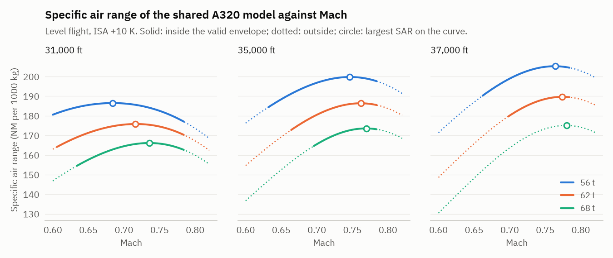
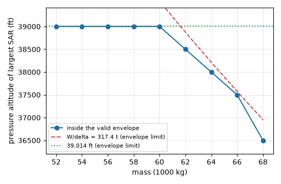

# Use a model

This page shows how to use a model in Python, with ONNX and in CasADi, how to build the inputs from ADS-B or Mode S data, and how a tool should use the valid envelope. The inputs and their units are in [model.md](model.md). Each section links to a runnable script in [`examples/`](../examples/README.md).

The Python snippets on this page run from the repository root in one Python session, in the order of the page (`uv run --group casadi python`).

## Python

`fuel_flow` takes flight conditions. `sin_gamma` is the geometric vertical speed divided by the true airspeed, and `acc_in` is (groundspeed / true airspeed) x (d groundspeed / dt) / g; both are 0 by default (steady level flight in still air). The arguments broadcast, so arrays give arrays.

```python
import numpy as np

from neuralfuel import atmos
from neuralfuel.inference import fuel_flow, predict
from neuralfuel.model import load

model = load("models/a320/nf-a320-cfm56_5b.pt")
fuel_flow(model, mach=0.78, alt_ft=37000, mass_kg=62000, sat_k=225.0)  # kg/h, cruise
fuel_flow(
    model, mach=0.70, alt_ft=25000, mass_kg=65000, sat_k=250.0, sin_gamma=0.05
)  # climb

# the six inputs: Mach, ln delta, ln mass, sin_gamma, acc_in, ln theta
alt_ft, sat_k = 37000.0, 225.0
ln_delta = np.log(atmos.isa_delta(alt_ft))  # ISA pressure ratio at pressure altitude
ln_theta = np.log(sat_k / atmos.T0)  # theta = SAT / 288.15 K
x = np.array([[0.78, ln_delta, np.log(62000.0), 0.0, 0.0, ln_theta]])
ff, outside = predict(model, x, outside=True)  # kg/h, True outside the envelope
```

`predict` also takes a DataFrame with the input columns. Example: [`examples/01_predict.py`](../examples/01_predict.py).

## Cruise performance

Specific air range (SAR) is true airspeed / fuel flow. [`examples/02_cruise_performance.py`](../examples/02_cruise_performance.py) computes it against Mach for the shared A320 model at three masses and three altitudes, and the altitude of the largest SAR against mass. It uses level flight at ISA +10 K; with the fixed temperature rule, SAR at a fixed Mach does not depend on the temperature.



Solid lines are inside the valid envelope, dotted lines outside. At 37,000 ft and 68 t no state is inside: W/delta is 318.0 t, above the 99 % quantile of the level-flight blocks (317.4 t).



Inside the envelope, the best state lies on an envelope limit: the altitude limit of level flight for the light masses and the W/delta limit for the heavy masses. Its Mach (0.766 to 0.782) is below the Mach limit of level flight (0.786). Outside these limits the model extrapolates; above Mach 0.786 the shape of the curves comes from the drag-rise term P7 (aerox drag model and the assumption on TSFC), not from data. The figures come from `uv run --group examples examples/02_cruise_performance.py --plot --out-dir docs/img`.

## Inputs from ADS-B or Mode S data

Train on data where airspeed, temperature and mass are accurate, such as recorder data. Apply the trained model to ADS-B or Mode S data with `neuralfuel.inference.surveillance_inputs`. It builds the same six inputs from:

- the sample time (s), sorted within each track (for example at 1 s or 4 s steps);
- the barometric (pressure) altitude (ft);
- the groundspeed (kt);
- one airspeed: `cas_kt`, `tas_kt` or `mach`;
- the static air temperature (K), for example from a weather model;
- the mass (kg), an estimate;
- optionally a track label `track_id`.

The time step comes from the time differences inside each track (`neuralfuel.inference.track_segments`): a new segment starts at a new track, at a gap and at a change of the step, so tracks at different steps are each used at their own step. The vertical speed and the groundspeed rate come from a Savitzky-Golay filter (order 2) of about 21 s (`window_s`) inside each segment, at the step of the segment. Samples in segments shorter than the filter give NaN. The track angle and the reported vertical rate are not used.

```python
from neuralfuel.inference import surveillance_inputs

t = np.arange(0.0, 120.0, 4.0)  # s
alt = 30000.0 + 25.0 * t  # ft, climb at 1500 ft/min
xs = surveillance_inputs(
    t,
    alt,
    gs_kt=420.0,
    mass_kg=64000.0,
    sat_k=atmos.isa_temperature(alt) + 10.0,
    mach=0.74,
)
fuel_flow_kgh = predict(model, xs)
```

Do not train on surveillance-quality inputs. The surveillance-input test of the validation report shows the effect of Mode S resolution on the accuracy (see [validation.md](validation.md)). A trajectory with a mass update along the flight and the trip fuel: [`examples/03_trajectory_fuel.py`](../examples/03_trajectory_fuel.py).

## ONNX

The `.onnx` file takes the input `x`, float32 of shape (n, 6), in the order of the inputs, ln theta included, for every temperature rule. It returns `ln_fuel_flow`, shape (n, 1), ln of the fuel flow in kg/h. The graph applies the temperature rule inside and has no Squeeze node. The metadata entry `neuralfuel_aircraft` holds the aircraft settings (JSON), `neuralfuel_envelope` the valid envelope (JSON). At 37,000 ft pressure altitude the ISA pressure ratio delta is 0.2138 (`neuralfuel.atmos.isa_delta(37000)`).

```python
import json

import onnxruntime as ort

sess = ort.InferenceSession("models/a320/nf-a320-cfm56_5b.onnx")
delta = atmos.isa_delta(37000.0)  # 0.2138
x32 = np.array(
    [[0.78, np.log(delta), np.log(62000), 0.0, 0.0, np.log(225.0 / atmos.T0)]],
    np.float32,
)
ln_ff = sess.run(None, {"x": x32})[0]  # ln of fuel flow in kg/h, shape (1, 1)
np.exp(ln_ff)  # kg/h

meta = sess.get_modelmeta().custom_metadata_map
aircraft = json.loads(meta["neuralfuel_aircraft"])
envelope = json.loads(meta["neuralfuel_envelope"])
```

With neuralfuel installed, `neuralfuel.inference.onnx_metadata(path)` returns both entries. A script with only `onnxruntime` and `numpy`, without torch and neuralfuel, including the ISA pressure ratio and the envelope test: [`examples/04_onnx_without_torch.py`](../examples/04_onnx_without_torch.py).

## CasADi

`neuralfuel.inference.casadi_function(onnx_file)` imports the exported ONNX file into CasADi as a symbolic function of the six inputs (1, 6) to ln of fuel flow (1, 1). It reads the file without external data and raises ValueError for a graph with tensors in an external file, before CasADi reads the graph; the files of `export_onnx` are self-contained. The CasADi importer has no Softplus and no Squeeze operator: the export has no Squeeze node, and the function rewrites Softplus as log(1 + exp(x)) before the import. `export --casadi` writes this form into the file for other importers without Softplus; `casadi_function` does not need it. The form is smooth for an optimizer, but exp overflows in float32 above about 88.7: the export with `--casadi` is refused when the largest hidden pre-activation at states inside the envelope is above 80 (`MAX_PREACTIVATION`). The shared A320 models stay below 45. The batch dimension is 1; use `Function.map` for many states. `expand=True` converts the graph to scalar expressions (SX); for these dense layers the matrix graph (MX, the default) evaluated faster in the tests of the package.

CasADi is not a dependency of the package; it is in the optional dependency group `casadi` (`uv sync --group casadi`).

```python
import casadi as ca

from neuralfuel.inference import casadi_function

f = casadi_function("models/a320/nf-a320-cfm56_5b.onnx")  # x (1, 6) -> ln fuel flow
xs_sym = ca.MX.sym("x", 1, 6)
fuel = ca.Function("fuel", [xs_sym], [ca.exp(f(xs_sym))])
float(fuel(x))  # kg/h at the state x above
```

`neuralfuel.inference.casadi_check(model, onnx_file, x)` compares the import with PyTorch (float64) at the states `x`: the largest differences of ln F, its gradient and its Hessian, and the CasADi evaluation time per state.

The test of the import is skipped when CasADi is not installed:

```sh
uv run --group casadi pytest tests/test_casadi.py
```

[`examples/05_casadi_optimize.py`](../examples/05_casadi_optimize.py) runs this check on 1,000 random states inside the envelope (`--states`; `--report` takes the envelope from a validation report for a file without one) and then finds the Mach and altitude of maximum specific air range at a given mass with IPOPT, with the bounds from the valid envelope (both sides of the Mach, altitude and W/delta ranges of level flight, and the cruise limits). It first checks the fixed inputs (mass, ISA deviation, zero energy rate) against the level-flight ranges; a mass outside them gives no optimum. With `--model run/model.pt --onnx run/model.onnx` it uses another model.

## Valid envelope

The valid envelope describes where a model has training data (`neuralfuel.support`). Training computes it from the training blocks and steady windows and stores it in the model file (`model.envelope`), the run record, the validation report and the ONNX metadata (`neuralfuel_envelope`, JSON). A tool such as a trajectory optimizer can read it from any of these. It holds:

- for all blocks and per phase (climb, level, descent): the number of blocks and the range from the 1 % to the 99 % quantile of Mach, pressure altitude, mass, W/delta, ISA deviation, sin_gamma and acc_in;
- from the steady cruise windows: the largest W/delta and the largest lift coefficient CL = 2 m g / (gamma p0 delta M² S), with gamma = 1.4 and S the wing area of the aircraft settings (only with a wing area);
- the phase rule: climb above +300 ft/min and descent below -300 ft/min geometric vertical speed, else level; cruise is level flight above 25,000 ft.

`in_envelope(envelope, x)` returns True for the model inputs x (an (n, 6) array in the order of the inputs, or a DataFrame) that lie inside: every variable inside the range of the phase of the state, and in cruise W/delta and CL not above the cruise maxima. The ranges are 1 % to 99 % quantiles per variable, so several per cent of the training blocks themselves are outside. `predict(model, x, outside=True)` returns the fuel flow and a flag that is True outside the envelope. Outside the envelope the model still returns a value; the flag tells that no training data supports it.

```python
from neuralfuel.inference import onnx_metadata
from neuralfuel.support import in_envelope

ff, outside = predict(model, x, outside=True)
envelope = onnx_metadata("models/a320/nf-a320-cfm56_5b.onnx")["envelope"]
inside = in_envelope(envelope, x)
```

For a model that was continued from shared weights, the envelope is the union of the envelope of the shared model and that of the local training data (per phase the lowest minimum and the highest maximum); the run record also holds the local envelope alone (`local_envelope`). The union is a box per phase, so it can span gaps between the joined envelopes. Its block and window counts are sums, which over rounds of aggregation count training exposures, not unique observations. The bounds are inclusive with a relative tolerance of 1e-9 (`BOX_RTOL`), so that a state on a bound stays inside after the log and exp transforms of the inputs. A cruise limit without a value means no limit: the union has no limit if one of its envelopes has level blocks above the cruise altitude and no limit. Envelopes with another format, other quantiles, another phase rule or another wing area are not joined.

How a tool should use the envelope:

- In fuel estimation, report the share of states outside the envelope with the result, as [`examples/03_trajectory_fuel.py`](../examples/03_trajectory_fuel.py) does.
- In an optimizer, use the ranges of the phase and the cruise limits as bounds or constraints, as [`examples/05_casadi_optimize.py`](../examples/05_casadi_optimize.py) does. An optimum on an envelope limit is a result of the data region, not of the aircraft.
- Use the envelope of the model file or of its ONNX metadata, not the ranges of the model card, which can belong to an older model.

## Private local offsets

Private local offsets (see "Private local correction" in [federated.md](federated.md)), after `uv run neuralfuel local-fit prep --model models/a320/nf-a320-cfm56_5b.pt --out work/private/offsets.json` on the prepared data of the quick start:

```python
from neuralfuel.local import offsets_for, read_offsets

offsets = offsets_for(read_offsets("work/private/offsets.json"), "all")
ff_local = predict(model, x, offsets=offsets)  # "all": the data has no tail column
```

Example with two aircraft: [`examples/08_local_offsets.py`](../examples/08_local_offsets.py).

## Comparison with OpenAP

[`examples/09_compare_openap.py`](../examples/09_compare_openap.py) compares the shared A320 model with the OpenAP fuel model on a small grid (dependency group `reference`). The full comparison is `neuralfuel compare` (see [federated.md](federated.md) and [cli.md](cli.md)).
